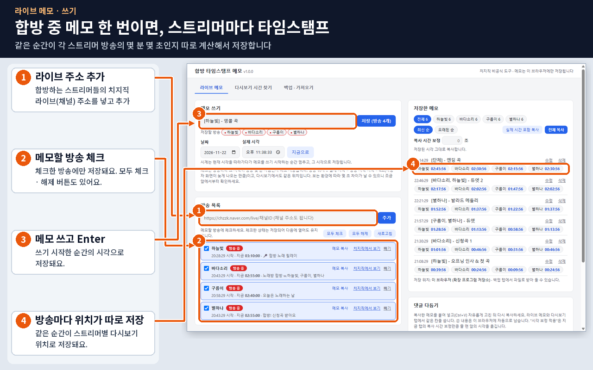
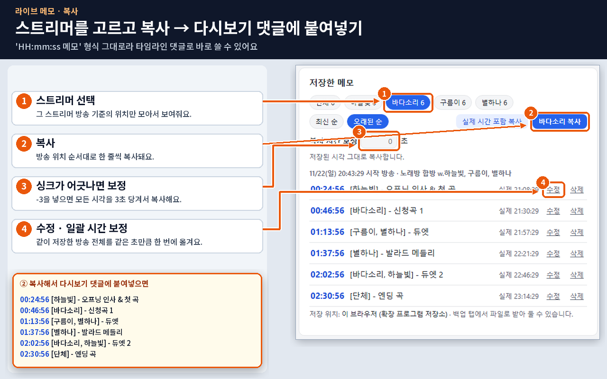
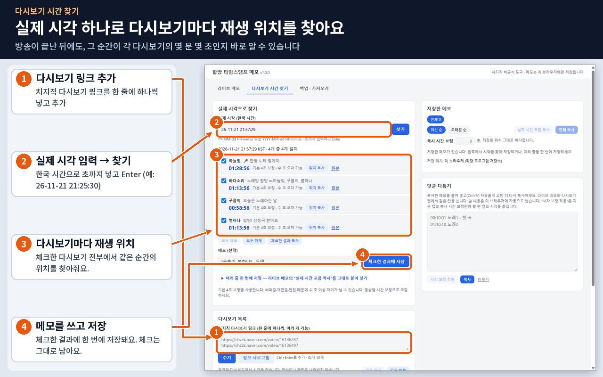
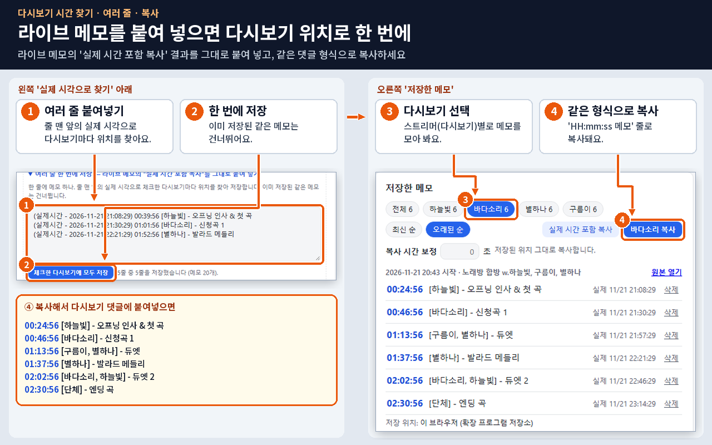

# 합방 타임스탬프 메모 (치지직용)

치지직 합방을 보다가 노래나 명장면이 나오면 메모를 한 번만 쓰세요. 체크해 둔 스트리머마다 "그 순간이 각자 방송의 몇 분 몇 초인지"를 따로 계산해 저장합니다. 방송이 끝난 뒤 스트리머를 골라 복사하면, 그 스트리머의 다시보기 댓글에 바로 붙여 넣을 수 있는 타임스탬프 목록이 만들어집니다.

```
00:24:56 [하늘빛] - 오프닝 인사 & 첫 곡
00:46:56 [바다소리] - 신청곡 1
01:13:56 [구름이, 별하나] - 듀엣
```

Chrome · Edge · 웨일 확장 프로그램이라 Windows와 Mac에서 똑같이 동작하고, 메모는 브라우저 안에만 저장됩니다.

| 라이브 메모 쓰기 | 스트리머별 복사 |
|---|---|
|  |  |
| **다시보기 시간 찾기** | **여러 줄 한 번에 · 같은 형식으로 복사** |
|  |  |

> 화면 속 스트리머와 방송은 모두 지어낸 예시입니다.

## 기능

**라이브 메모**
1. 합방 중인 스트리머들의 치지직 라이브 주소(또는 채널 주소)를 방송 목록에 추가합니다.
2. 메모할 방송에 체크합니다. 모두 체크 · 모두 해제 버튼이 있고, 체크 상태는 다음에 열어도 유지됩니다.
3. 장면이 나오면 메모를 쓰고 Enter를 누릅니다. 메모를 쓰기 시작한 순간의 시각으로 저장됩니다.
4. 방송이 끝나면 스트리머를 골라 "복사"를 누르고 다시보기 댓글에 붙여 넣습니다.

그 밖의 기능:
- 줄마다 실제 시각을 붙여 복사할 수 있습니다.
- 싱크가 맞지 않으면 복사할 때 ±n초 보정할 수 있습니다.
- 저장한 메모를 고칠 수 있고, 같이 저장한 방송 전체의 시간을 한 번에 보정할 수 있습니다.
- 복사한 내용을 붙여 넣고 다듬는 "댓글 다듬기" 칸이 있습니다.

**다시보기 시간 찾기**
1. 치지직 다시보기 링크를 추가합니다.
2. 실제 시각(한국 시간)을 입력하면 다시보기마다 그 시각의 재생 위치를 찾아 줍니다.
3. 찾은 위치에 메모를 저장하고, 라이브 메모와 같은 `HH:mm:ss 메모` 형식으로 복사합니다.
4. 라이브 메모의 "실제 시간 포함 복사" 결과를 붙여 넣으면, 여러 줄을 한 번에 다시보기 위치로 바꿔 저장합니다.

**백업 · 가져오기**: 메모를 파일로 내려받고 다시 가져올 수 있습니다. 확장 프로그램을 삭제하면 메모도 함께 지워집니다.

방송 위치는 `실제 시각 − 방송 시작 시각 − 4초(시청자 화면 지연)`로 계산합니다. 보는 환경에 따라 몇 초 차이가 날 수 있습니다.

## 설치

### 직접 설치 (개발자 모드)
1. 이 저장소를 내려받습니다(Code → Download ZIP 후 압축 해제, 또는 `git clone`).
2. 주소창에 `chrome://extensions`를 엽니다. Edge는 `edge://extensions`, 웨일은 `whale://extensions`입니다.
3. 오른쪽 위 **개발자 모드**를 켭니다.
4. **압축해제된 확장 프로그램을 로드합니다**를 누르고 `src` 폴더를 고릅니다.
5. 툴바의 퍼즐 아이콘에서 핀을 꽂아 두고, 아이콘을 누르면 메모 화면이 열립니다.

코드를 고친 뒤에는 확장 프로그램 카드의 새로고침(↻) 버튼을 누르고, 열려 있던 메모 탭도 새로고침하세요.

## 개인정보

- 메모는 브라우저 안(`chrome.storage.local`)에만 저장되고, 어디로도 보내지 않습니다. 광고나 사용 기록 수집도 없습니다.
- 외부 통신은 `api.chzzk.naver.com`에서 채널 · 방송 · 다시보기의 시작 시각과 길이를 조회하는 것뿐입니다. 로그인 정보(쿠키)는 보내지 않습니다.
- 자세한 내용은 [개인정보처리방침](store/privacy-policy.md)에 있습니다.

## 권한

| 권한 | 쓰는 곳 |
|---|---|
| `storage` | 채널 목록과 메모를 브라우저 안에 저장 |
| `https://api.chzzk.naver.com/*` | 방송 · 다시보기 시작 시각 조회 |

치지직 API는 다른 사이트에서 온 요청(Origin 헤더가 붙은 요청)을 거부합니다. 확장 프로그램 페이지가 호스트 권한으로 보내는 GET 요청에는 Origin이 붙지 않아서, 요청 헤더를 바꾸는 권한(declarativeNetRequest) 없이 동작합니다.

## 폴더 구조

| 경로 | 내용 |
|---|---|
| `src/` | 확장 프로그램 본체. 이 폴더가 그대로 패키지가 됩니다 |
| `src/lib/chzzk.js` | 치지직 공개 API 조회 |
| `src/lib/livestore.js` | 라이브 메모 저장 · 계산 |
| `src/lib/vodstore.js` | 다시보기 시간 찾기 |
| `src/lib/backend.js` | 화면의 `api("/api/...")` 호출을 페이지 안에서 처리하고, 백업과 가져오기를 맡음 |
| `src/app.html`, `app.js`, `vodmemo.js`, `style.css` | 화면 |
| `src/background.js` | 툴바 버튼: 메모 화면을 열거나, 이미 열려 있으면 그 탭으로 이동 |
| `tests/test_stores.js` | 저장 · 계산 로직 테스트 |
| `build.py` | 스토어에 올릴 zip 만들기 |
| `store/` | 스토어 등록 문구, 개인정보처리방침, 캡처화면, 프로모션 이미지 (패키지에는 들어가지 않음) |
| `sync_from_desktop.py`, `shell/` | 아래 "데스크톱 앱과의 관계" 참고 |

## 테스트와 빌드

```
node tests/test_stores.js        # 저장 · 계산 로직 15개 시나리오 (Node 18 이상)
python build.py                  # dist/chzzk-memo-extension-<버전>.zip
```

새 버전을 낼 때는 `src/manifest.json`의 `version`을 먼저 올리세요.

## 데스크톱 앱과의 관계

이 확장은 로컬 데스크톱 앱 "STT Timeline"의 라이브 메모 · 다시보기 시간 찾기 탭을 떼어 낸 것입니다. 데스크톱 앱은 이 저장소에 들어 있지 않습니다.

- **저장 · 계산 로직**(`src/lib`): 데스크톱 앱의 Python 코드를 JavaScript로 옮겼습니다.
- **데이터 형식**: 데스크톱 앱의 `live_memos.json` / `vod_memos.json`과 같습니다. "백업 · 가져오기" 탭에서 그 파일을 그대로 가져올 수 있습니다.
- **화면**(`src/app.html` 등): 데스크톱 앱의 화면 파일로 만듭니다. 데스크톱 앱이 있다면 `python sync_from_desktop.py <stt_timeline/web 경로>`로 다시 가져옵니다.
- **`shell/`**: 확장에만 있는 부분입니다(페이지 머리, 탭 버튼, 백업 탭, `api()` 연결, 탭 간 동기화).

이 저장소만 받은 경우에는 `src/`를 직접 고치면 됩니다.

## 라이선스

[MIT](LICENSE)

이 도구는 치지직(NAVER)이 만들거나 승인한 것이 아닌 비공식 도구입니다.
